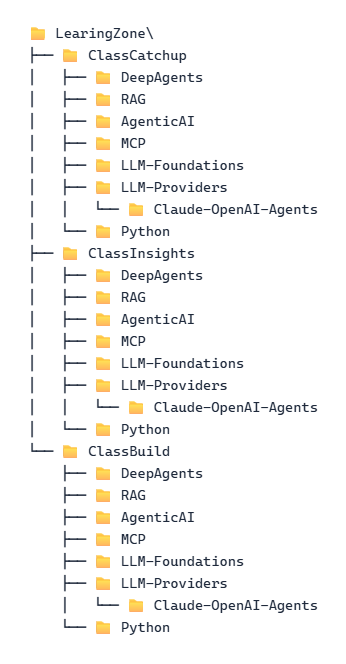

# 🚀 GenAI Learning Workspace

## Folder Structure & Setup Guide

A practical guide for organizing your **class recordings, personal
learning notes, and hands-on projects** across Windows and macOS.

> **The simple idea:** Keep what you watch, what you learn, and what you
> build in three separate places.

------------------------------------------------------------------------

## 🧭 At a glance

| Folder             | Purpose                          | GitHub                                      |
|--------------------|----------------------------------|---------------------------------------------|
| 🎥 `classcatchup`  | Class recordings                 | Local storage by default                    |
| 📝 `classinsights` | Personal notes and key learnings | One **private** repository                  |
| 💻 `classbuild`    | Practice code and projects       | One **public** repository for approved work |

**Your workspace contains:** 3 main folders · 7 topic folders · 2 GitHub
repositories.

------------------------------------------------------------------------

## 📚 Table of contents

1.  [Recommended folder structure](#1--recommended-folder-structure)
2.  [Understand the three main
    folders](#2--understand-the-three-main-folders)
3.  [The seven topic folders](#3--the-seven-topic-folders)
4.  [Folder and file naming
    standards](#4--folder-and-file-naming-standards)
5.  [Create the workspace on
    Windows](#5--create-the-workspace-on-windows)
6.  [Create the workspace on macOS](#6--create-the-workspace-on-macos)
7.  [Create and clone your two GitHub
    repositories](#7--create-and-clone-your-two-github-repositories)
8.  [Where should each file go?](#8--where-should-each-file-go)
9.  [GitHub security checklist](#9--github-security-checklist)
10. [Final setup checklist](#10--final-setup-checklist)

------------------------------------------------------------------------

## 1. 📁 Recommended folder structure

Your main workspace folder is named `learningzone`.

``` text
📁 learningzone/
│
├── 💻 classbuild/                         # Hands-on practice & projects
│   └── 📦 <your-public-repository>/
│       ├── 🤖 agentic-ai/
│       ├── 🧠 deep-agents/
│       ├── 📚 llm-foundations/
│       ├── 🔌 llm-providers/
│       │   └── 🤝 claude-openai-agents/
│       ├── 🔗 mcp/
│       ├── 🐍 python/
│       └── 📖 rag/
│
├── 🎥 classcatchup/                       # Class recordings
│   ├── 🤖 agentic-ai/
│   ├── 🧠 deep-agents/
│   ├── 📚 llm-foundations/
│   ├── 🔌 llm-providers/
│   │   └── 🤝 claude-openai-agents/
│   ├── 🔗 mcp/
│   ├── 🐍 python/
│   └── 📖 rag/
│
└── 📝 classinsights/                      # Notes & key learnings
    └── 🔒 <your-private-repository>/
        ├── 🤖 agentic-ai/
        ├── 🧠 deep-agents/
        ├── 📚 llm-foundations/
        ├── 🔌 llm-providers/
        │   └── 🤝 claude-openai-agents/
        ├── 🔗 mcp/
        ├── 🐍 python/
        └── 📖 rag/
```



### 🔎 How to read this structure

- `<your-public-repository>` is the repository you create for practical
  work and clone inside `classbuild`.
- `<your-private-repository>` is the repository you create for personal
  notes and clone inside `classinsights`.
- The seven topic folders are created **inside each cloned GitHub
  repository**.
- `classcatchup` stores class recordings locally. It is not a GitHub
  repository by default.
- `claude-openai-agents` is a nested folder inside `llm-providers`. It
  is not an eighth topic.

> **Important:** The repository names shown above are placeholders.
> Choose your own repository names on GitHub.

------------------------------------------------------------------------

## 2. 🗂️ Understand the three main folders

### 🎥 `classcatchup` — Watch and revisit

Store class recordings here, organized by the topic covered in each
session.

**Example:**

``` text
🎥 classcatchup/
└── 🐍 python/
    ├── 🎬 class-01-recording.mp4
    ├── 🎬 class-02-recording.mp4
    └── 🎬 class-03-recording.mp4
```

**Save here:** - Class recording videos - Topic-wise session
recordings - Approved reference recordings

Keep recordings in the storage location approved by your instructor. Do
not upload large or restricted class recordings to GitHub unless you
have permission.

### 📝 `classinsights` — Learn and understand

Store your own notes and revision material in your **private GitHub
repository**.

**Example:**

``` text
🔒 <your-private-repository>/
└── 🐍 python/
    ├── 📄 python-basics.md
    ├── 📄 python-functions.md
    └── 📄 python-oop.md
```

**Save here:** - Key points from each class - Concepts and definitions
in your own words - Explanations of how something works - Useful
commands and code snippets - Questions and topics to revise later

### 💻 `classbuild` — Practise and implement

Store your practical work in your **public GitHub repository**, provided
the content is suitable for public sharing.

**Example:**

``` text
📦 <your-public-repository>/
└── 🐍 python/
    ├── 📁 01-python-basics/
    │   └── 🐍 main.py
    ├── 📁 02-python-functions/
    │   └── 🐍 main.py
    └── 📁 03-python-oop/
        └── 🐍 main.py
```

**Save here:** - Practice programs - Step-by-step exercises -
Assignments that are approved for sharing - Small applications and
mini-projects - Completed implementations

------------------------------------------------------------------------

## 3. 🧩 The seven topic folders

Use these exact topic folder names in both GitHub repositories and under
`classcatchup`.

| Icon | Folder name       | What belongs here                                              |
|------|-------------------|----------------------------------------------------------------|
| 🤖   | `agentic-ai`      | AI agents, agent workflows, and related concepts               |
| 🧠   | `deep-agents`     | Deep Agents concepts, exercises, and implementations           |
| 📚   | `llm-foundations` | LLM fundamentals and core concepts                             |
| 🔌   | `llm-providers`   | Model providers, APIs, and SDKs                                |
| 🔗   | `mcp`             | Model Context Protocol, clients, servers, tools, and resources |
| 🐍   | `python`          | Python concepts, examples, and practice programs               |
| 📖   | `rag`             | Retrieval-Augmented Generation concepts and implementations    |

### 🤝 Nested folder: `claude-openai-agents`

For Claude- and OpenAI-based agent-building work, use this folder inside
`llm-providers`:

``` text
🔌 llm-providers/
└── 🤝 claude-openai-agents/
```

------------------------------------------------------------------------

## 4. ✍️ Folder and file naming standards

Use one naming convention across Windows, macOS, and GitHub.

| Rule                    | ✅ Use this       | ❌ Avoid this     |
|-------------------------|-------------------|-------------------|
| Lowercase names         | `python`          | `Python`          |
| Hyphens between words   | `llm-foundations` | `llm_foundations` |
| Exact main folder names | `classinsights`   | `class-insights`  |
| Lowercase extensions    | `notes.md`        | `notes.MD`        |

### Why use lowercase?

Windows and macOS are commonly configured with case-insensitive
filesystems, while Linux is generally case-sensitive. Consistent
lowercase names help prevent path and Git issues when sharing work
across systems.

**Follow these rules:**

1.  Use lowercase letters for folder and file names.
2.  Use hyphens (`-`) between words in multi-word names.
3.  Keep the three main folder names exactly as `classbuild`,
    `classcatchup`, and `classinsights`.
4.  Keep file extensions lowercase, such as `.md`, `.py`, and `.mp4`.
5.  Do not create names that differ only by capitalization, such as
    `python` and `Python`.

------------------------------------------------------------------------

## 5. 🪟 Create the workspace on Windows

<blockquote>

**Required Windows location:** `C:\learningzone`

Create `learningzone` directly under the C: drive. Do not create it
inside your user folder, Desktop, Documents, or Downloads.
</blockquote>

### Option A — Create folders using File Explorer

1.  Open **File Explorer**.

2.  Select **This PC**.

3.  Open **Local Disk (C:)**.

4.  Create a folder named `learningzone`.

5.  Inside it, create these three folders:

    ``` text
    classbuild
    classcatchup
    classinsights
    ```

6.  Inside `classcatchup`, create the seven topic folders listed in
    [Section 3](#3--the-seven-topic-folders).

7.  Inside `classcatchup\llm-providers`, create `claude-openai-agents`.

### Option B — Create folders using the PowerShell script

1.  Download the [Windows PowerShell setup
    script](scripts/windows/create-genai-folders-windows.ps1).

2.  Save the file in your **Downloads** folder.

3.  Open **PowerShell**.

4.  Run this command:

    ``` powershell
    powershell -NoProfile -ExecutionPolicy Bypass -File "$env:USERPROFILE\Downloads\create-genai-folders-windows.ps1"
    ```

The script creates the three main folders and the topic folders under
`classcatchup` at `C:\learningzone`.

It does **not** create topic folders inside `classbuild` or
`classinsights`. Those folders will be created inside your cloned GitHub
repositories in Section 7.

### ✅ Verify the Windows setup

Run:

``` powershell
Get-ChildItem -Path "C:\learningzone" -Directory -Recurse |
    Select-Object -ExpandProperty FullName
```

If Windows reports **Access denied**, check whether your account has
permission to create folders directly under `C:\` or contact your system
administrator. Do not change the required location without checking with
your instructor.

------------------------------------------------------------------------

## 6. 🍎 Create the workspace on macOS

On macOS, you can choose a suitable location. This guide uses your
Documents folder:

``` text
~/Documents/learningzone
```

### Option A — Create folders using Finder

1.  Open **Finder**.
2.  Open **Documents** (or your chosen parent folder).
3.  Create a folder named `learningzone`.
4.  Inside it, create `classbuild`, `classcatchup`, and `classinsights`.
5.  Inside `classcatchup`, create the seven topic folders listed in
    [Section 3](#3--the-seven-topic-folders).
6.  Inside `classcatchup/llm-providers`, create `claude-openai-agents`.

### Option B — Create folders using the Bash script

1.  Download the [macOS Bash setup
    script](scripts/macos/create-genai-folders-macos.sh).

2.  Open **Terminal**.

3.  Navigate to the parent folder where you want `learningzone` created.
    For example:

    ``` bash
    cd "$HOME/Documents"
    ```

4.  Run the downloaded script:

    ``` bash
    bash "$HOME/Downloads/create-genai-folders-macos.sh"
    ```

The script creates `learningzone` in the directory from which you run
it. It creates the three main folders and the topic folders under
`classcatchup`. It does not delete existing files or folders.

### ✅ Verify the macOS setup

If you used Documents, run:

``` bash
find "$HOME/Documents/learningzone" -type d -print | sort
```

------------------------------------------------------------------------

## 7. 🐙 Create and clone your two GitHub repositories

You need **two repositories only** — not one repository per topic.

| Repository                     | Visibility                        | Clone it inside |
|--------------------------------|-----------------------------------|-----------------|
| 📝 Learning notes              | **Private**                       | `classinsights` |
| 💻 Practical work and projects | **Public** (for approved content) | `classbuild`    |

### Step 1 — Create your private learning-notes repository

1.  Sign in to [GitHub](https://github.com/).
2.  Select **New repository**.
3.  Choose a meaningful name of your own. Examples:
    - `genai-learning-notes`
    - `my-learning-notes`
    - `genai-knowledge-base`
4.  Set repository visibility to **Private**.
5.  Create the repository and copy its URL.

**Clone into `classinsights`.**

Windows — PowerShell:

``` powershell
Set-Location "C:\learningzone\classinsights"
git clone <your-private-repository-url>
```

macOS — Terminal (if you used Documents):

``` bash
cd "$HOME/Documents/learningzone/classinsights"
git clone <your-private-repository-url>
```

### Step 2 — Create your public projects repository

1.  On GitHub, select **New repository** again.
2.  Choose a meaningful name of your own. Examples:
    - `genai-projects`
    - `genai-implementations`
    - `my-ai-projects`
3.  Set repository visibility to **Public** only if you are comfortable
    sharing the contents.
4.  Create the repository and copy its URL.

**Clone into `classbuild`.**

Windows — PowerShell:

``` powershell
Set-Location "C:\learningzone\classbuild"
git clone <your-public-repository-url>
```

macOS — Terminal:

``` bash
cd "$HOME/Documents/learningzone/classbuild"
git clone <your-public-repository-url>
```

Replace each placeholder with the actual URL copied from GitHub. Do not
type the angle brackets.

### Step 3 — Create the seven topic folders inside both repositories

After cloning:

1.  Open the cloned private repository inside `classinsights`.
2.  Create all seven topic folders listed in Section 3.
3.  Open the cloned public repository inside `classbuild`.
4.  Create the same seven topic folders there.
5.  Inside each repository’s `llm-providers` folder, create
    `claude-openai-agents`.

> **Remember:** `git clone` downloads a repository. It does not
> automatically create your seven topic folders unless you have already
> added them to that repository.

### Example — What the completed workspace looks like

``` text
📁 learningzone/
│
├── 💻 classbuild/
│   └── 📦 genai-projects/                 # Example repository name
│       ├── 🤖 agentic-ai/
│       ├── 🧠 deep-agents/
│       ├── 📚 llm-foundations/
│       ├── 🔌 llm-providers/
│       │   └── 🤝 claude-openai-agents/
│       ├── 🔗 mcp/
│       ├── 🐍 python/
│       └── 📖 rag/
│
├── 🎥 classcatchup/
│   └── ... topic folders for recordings ...
│
└── 📝 classinsights/
    └── 🔒 genai-learning-notes/           # Example repository name
        ├── 🤖 agentic-ai/
        ├── 🧠 deep-agents/
        ├── 📚 llm-foundations/
        ├── 🔌 llm-providers/
        │   └── 🤝 claude-openai-agents/
        ├── 🔗 mcp/
        ├── 🐍 python/
        └── 📖 rag/
```

The repository names in this example are for illustration only. Use the
names you chose on GitHub.

------------------------------------------------------------------------

## 8. 📌 Where should each file go?

| Your material                        | Save it here                                                         |
|--------------------------------------|----------------------------------------------------------------------|
| 🎬 Class recording                   | `classcatchup/<topic>/`                                              |
| 📝 Personal class notes              | `classinsights/<private-repository>/<topic>/`                        |
| 📚 Key concepts and revision notes   | `classinsights/<private-repository>/<topic>/`                        |
| 🐍 Practice code and exercises       | `classbuild/<public-repository>/<topic>/`                            |
| 🚀 Mini-projects and implementations | `classbuild/<public-repository>/<topic>/`                            |
| 🤝 Claude/OpenAI agent-building work | `llm-providers/claude-openai-agents/` inside the relevant repository |

Replace `<topic>` with one of the seven folder names, such as `python`,
`rag`, or `mcp`.

### Example — After one Python class

| What you have after class | Where it goes                                |
|---------------------------|----------------------------------------------|
| Recording video           | `classcatchup/python/`                       |
| Your personal notes       | `classinsights/<private-repository>/python/` |
| Your Python program       | `classbuild/<public-repository>/python/`     |

Follow the same workflow for every topic.

------------------------------------------------------------------------

## 9. 🔐 GitHub security checklist

Before committing or pushing your work:

- [ ] Confirm your learning-notes repository is **Private**.
- [ ] Confirm your projects repository is **Public** only if the content
  is approved for sharing.
- [ ] Never commit API keys, passwords, access tokens, private keys, or
  cloud credentials.
- [ ] Add `.env` to `.gitignore` when it contains local secrets.
- [ ] Check that no secrets or restricted course materials are staged
  for commit.
- [ ] Follow your instructor’s rules for sharing assignments and course
  material.

> 🚨 **If a real secret is accidentally pushed to a public repository,
> treat it as exposed. Revoke or rotate that credential immediately.**

Keep a separate backup of important recordings, notes, and project work.

------------------------------------------------------------------------

## 10. ✅ Final setup checklist

Use this checklist after completing the setup.

### Workspace

- [ ] `learningzone` exists in the correct location.
- [ ] `classbuild`, `classcatchup`, and `classinsights` exist.
- [ ] The seven topic folders exist under `classcatchup`.
- [ ] `claude-openai-agents` is inside `llm-providers` under
  `classcatchup`.

### GitHub

- [ ] The private notes repository is cloned inside `classinsights`.
- [ ] The public projects repository is cloned inside `classbuild`.
- [ ] The seven topic folders exist inside both cloned repositories.
- [ ] `claude-openai-agents` is inside `llm-providers` in both
  repositories.
- [ ] No passwords, API keys, or other secrets are committed.

------------------------------------------------------------------------

## 🌟 Remember the workflow

| Folder             | Your action                                   |
|--------------------|-----------------------------------------------|
| 🎥 `classcatchup`  | **WATCH** what was taught.                    |
| 📝 `classinsights` | **UNDERSTAND** and document what you learned. |
| 💻 `classbuild`    | **PRACTISE** and implement what you learned.  |

> **One course. Three organized folders. Two GitHub repositories. Seven
> consistent topics.**

Happy Learning & Building! 🚀
