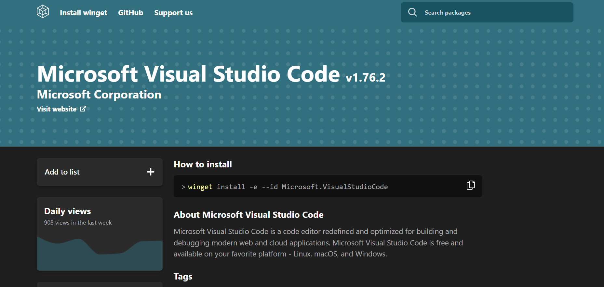
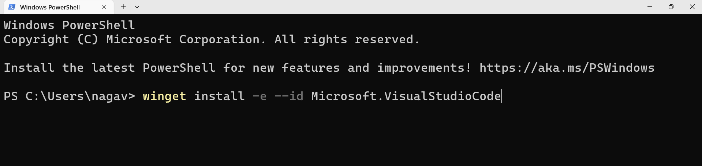
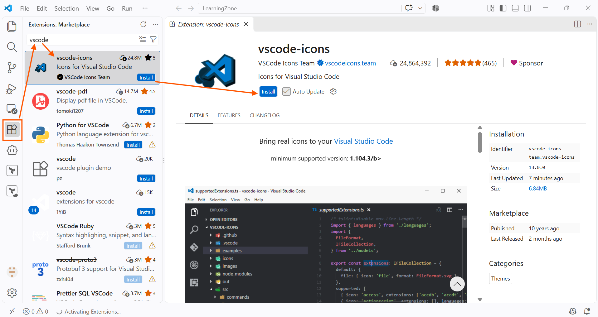
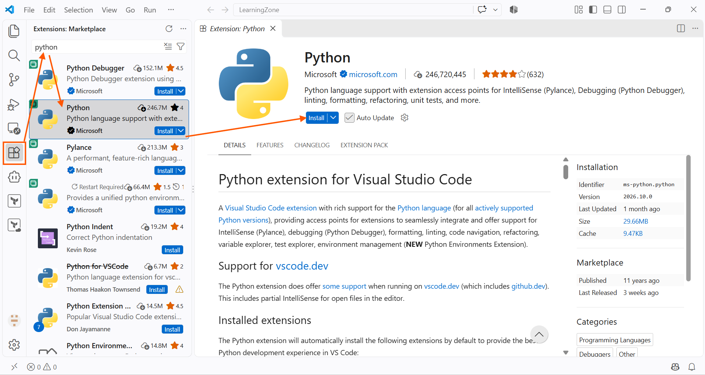
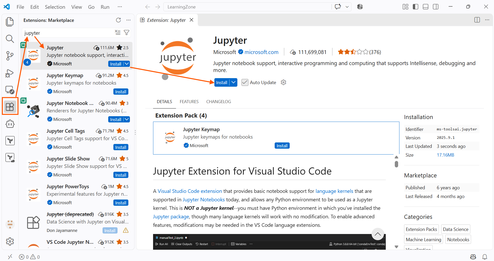

# VS code
## How to install VS code?
There are mainly **three** ways to install Visual Studio Code (VS Code):

1. Download and run the installer from the official VS Code website.  
2. Install using the Microsoft Store app on Windows.  
3. Use command-line package managers like `Winget` or `Chocolatey` for automated installation.  

[Refer Here](https://winget.run/pkg/Microsoft/VisualStudioCode) to install vscode.

- Let's install with winget



- Open your Terminal run the command to install VS Code 



##  What is VS code?

- Visual Studio Code (VS Code) is a free, lightweight code editor that supports multiple programming languages.
- It helps you write, edit, and run code efficiently with features like IntelliSense, debugging, and extensions.
- You start by opening a folder, creating files, and using its powerful tools for coding, testing, and debugging.
***
---

## Install VS Code Extensions

VS Code extensions provide additional features and language support to Visual Studio Code. For this GenAI with Python course, we need to install the following essential extensions.

### 1. Install VSCode Icons

**Purpose:**

VSCode Icons provides different icons for files and folders, making the project structure easier to identify and navigate.

**Installation Steps:**

1. Open Visual Studio Code.
2. Click the **Extensions** icon in the Activity Bar.
3. Search for `vscode-icons`.
4. Select **vscode-icons** published by **VSCode Icons Team**.
5. Click **Install**.




### 2. Install Python Extension

**Purpose:**

The Python extension provides Python language support in VS Code. It helps developers write, execute, debug, and manage Python code.

**Installation Steps:**

1. Open Visual Studio Code.
2. Open the Extensions Marketplace.
3. Search for `Python`.
4. Select **Python** published by **Microsoft**.
5. Verify the publisher and click **Install**.




### 3. Install Jupyter Extension

**Purpose:**

The Jupyter extension allows developers to create and execute Jupyter Notebooks (`.ipynb`) directly in VS Code.

It is useful for:

- Writing and executing Python code cell by cell.
- Experimenting with Python libraries.
- Practising LLM and Generative AI concepts.
- Performing data analysis and machine learning experiments.

**Installation Steps:**

1. Open Visual Studio Code.
2. Open the Extensions Marketplace.
3. Search for `Jupyter`.
4. Select **Jupyter** published by **Microsoft**.
5. Verify the publisher and click **Install**.



**Note:** To execute Python code in Jupyter Notebooks, ensure that Python and the `ipykernel` package are installed in your selected Python environment.

Install `ipykernel` using:

```powershell
python -m pip install ipykernel
```

### Installation Verification

After installing all three extensions, open the Extensions view and verify that they appear under the Installed section.

| Extension | Publisher |
|---|---|
| vscode-icons | VSCode Icons Team |
| Python | Microsoft |
| Jupyter | Microsoft |

**Result:** Visual Studio Code is now ready for Python development and Jupyter Notebook practice as part of the GenAI course.

---

